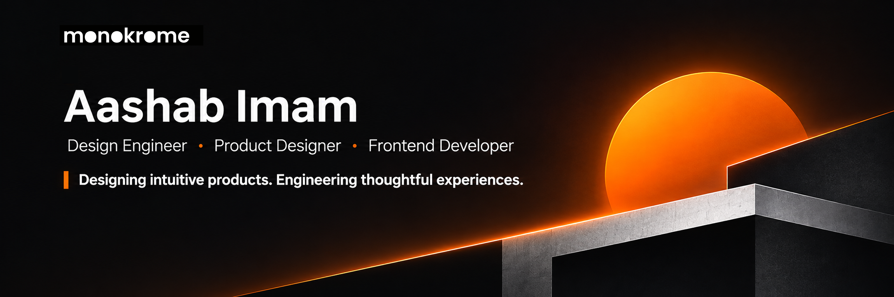

 

 

## About Me

I'm a **Design Engineer, Product Designer, and Frontend Developer** at **[MonoKrome Inc.](https://monokrome.dev)**, with **3+ years of professional experience** across product design and web application development.

I work at the intersection of design and engineering, transforming complex requirements into intuitive interfaces and functional digital products.

My work spans the complete product development process, from understanding requirements and designing interfaces in Figma to implementing frontend applications, integrating APIs, and developing supporting backend functionality.

I believe the best digital experiences are built through thoughtful design decisions, clean architecture, practical engineering, and continuous refinement.

 

## Technical Expertise

### Design & Product

### Frontend Engineering

### Backend & Application Development

 

## Engineering Philosophy

I believe good software is the result of thoughtful decisions across design, architecture, and implementation.

| Principle | Approach |
| :--- | :--- |
| **Design with intent** | Prioritize clarity, usability, visual consistency, and meaningful interactions. |
| **Build with structure** | Create maintainable components, reusable patterns, and understandable code. |
| **Think in systems** | Understand how interfaces, application logic, and data work together. |
| **Solve real problems** | Choose practical solutions based on requirements, not unnecessary complexity. |
| **Refine continuously** | Improve through feedback, iteration, and attention to detail. |

 

## Currently

Working at **[MonoKrome Inc.](https://monokrome.dev)** across product design, frontend engineering, and web application development.

My current areas of interest include:

- **Design Engineering** — Bridging visual design and production-ready code.
- **Product Development** — Building intuitive and useful digital experiences.
- **Frontend Architecture** — Developing scalable and maintainable applications.
- **Design Systems** — Creating consistent, reusable interface foundations.
- **AI & Developer Tooling** — Exploring practical applications of AI in software development.

 

## GitHub Activity

 

---

### Let's Build Something Meaningful

I'm interested in thoughtful products, ambitious ideas, and meaningful collaborations.

 

  

**Design with purpose. Build with logic. Deliver with care.**

Bangladesh · Open to meaningful collaborations

